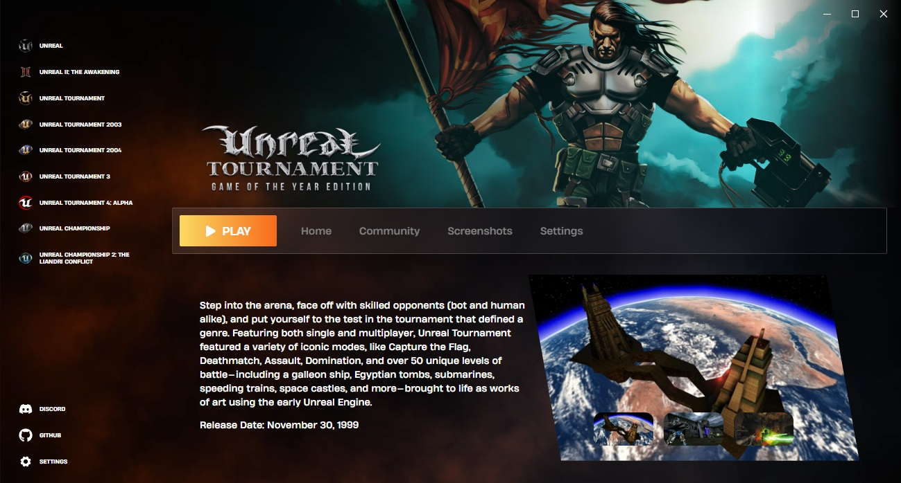

## UT Launcher

Standalone launcher for downloading and patching games from the Unreal series using Electron Forge, Typescript, React and a bit of WASM

## Features

- Download game files from the Internet Archive
- Predefined steps for extracting and installing available titles
- List and download patches for supported titles
- Screenshots grid display
- Settings tab with custom tweaks for each game
- Community tab for Discord servers
- Additional instructions for each game

## Contributing

You can help support the project by [donating to the Internet Archive](https://archive.org/donate), without them this wouldn't be possible. I can't list them all, but if possible make sure to support each community that helps with patches and keeping the games alive.

As for the actual launcher, you can help by pointing out any bugs and giving suggestions what can be improved.

This project is not affiliated with Epic Games or the Unreal brand in any way.

## Development

Required tools: `Node.js` v24 or above, `npm`

|                                   |                   |
| --------------------------------- | ----------------- |
| Install all required dependencies | `npm install`     |
| Starting the project              | `npm run start`   |
| Creating an executable            | `npm run package` |
|                                   |                   |

The project is split in two folders inside the `src/` directory:

- `backend/`
  - contains all the files used by Electron Forge
  - user data is handled and stored using `electron-store` defined in `userPreferences.ts`
  - IPC channels inside `preload.ts` are abstracted and handled using type definitions throughout the project, the `types` and `events` folders contain all handlers definitions
  - instructions for downloading and patching the games are defined inside the `workers` folder
  - the `config` folder contains predefined .ini files and additional configurations for each game
- `frontend/`
  - contains all React files for defining the user interface
  - the `contextBridge` object is used for communicating using IPC between the frontend and backend
  - `zustand` is used for state management defined in `useGlobalState.ts`

## Future Plans

This whole project started as a way for me to explore all the technologies used for creating a whole desktop app, I had a lot more planned but it needed to be scaled down due to time and complexity, everything about this is experimenting with ideas.

Maybe if there's enough interest I can try adding automatic feature updates, look into cross-platform configs and server creation from within the launcher, but we'll see.
